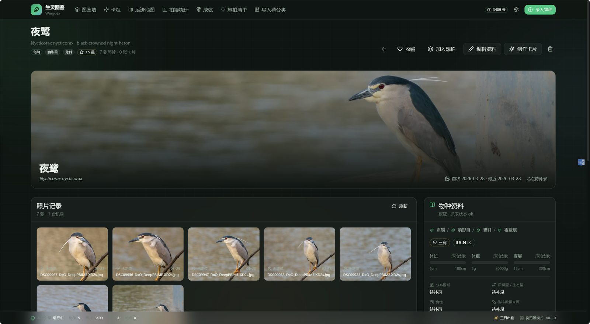
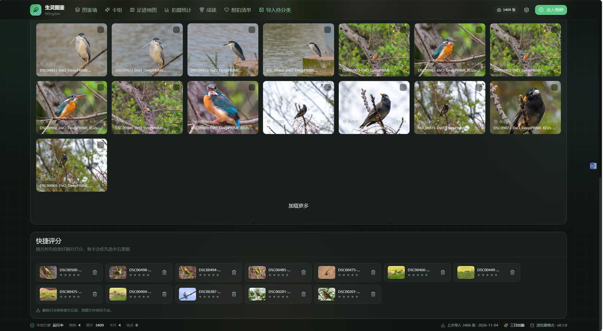

# Wingdex · 生灵图鉴

本地运行的拍鸟 / 野生动物摄影图鉴（Web + Electron 桌面端）：把拍到的照片收集成图鉴，录入物种名称后自动从维基百科与 Wikidata 抓取名称、分类、保护级别、形态量规与中英双语简介，并以「我拍到的照片 + 该物种简介」为核心，配合照片墙、足迹地图、时间热力日历、装备统计、成就体系与**高自由度动物卡编辑器**（固定比例、摄影元素卡背、3D 拖拽展示）浏览、检索、统计与收集。

- 完全离线可用：照片只索引不复制，数据库与缩略图都在本地。
- 统一设计系统：夜间深墨绿底 + 玻璃质感卡片 + 苔绿/羽青点缀，所有页面共用一套令牌与组件。
- 卡牌规则对齐游戏王：卡面文本短而密，超出容量直接拒绝保存而不是静默截断。

> 面向使用者的完整功能说明（不含实现细节）见 [`docs/功能文档.md`](docs/功能文档.md)。
> 设计与实现计划（卡面格线规范、卡片规则、成就定义等）见 [`docs/开发计划.md`](docs/开发计划.md)。

## 截图

**物种详情**



**导入待分类**



## 快速开始

环境：Node 20+，Windows / macOS / Linux 均可跑 Web 模式；打包桌面端需能下载 Electron 二进制。

```bash
npm install

# Web 模式：后端 http://127.0.0.1:5176 + Vite 前端 http://127.0.0.1:5273
npm run dev

# 桌面端开发：先构建前端再拉起 Electron（主进程内嵌本地服务，端口随机）
npm run dev:desktop

# 构建全部产物（前端 / 服务端 / 桌面端 dist）
npm run build

# Windows x64 便携版单文件 exe（输出 packages/desktop/release）
npm run dist:portable

# Windows x64 免安装目录包
npm run dist

# 三包类型检查
npm run typecheck
```

Windows 下也可以直接双击根目录的 `start.bat`：它会运行 `npm run dev`，等 Vite 前端（5273）真正响应后再打开浏览器。

## 数据位置与设置

数据目录在启动时按以下顺序决定，第一个可写的生效：

1. 环境变量 `BA_DATA_DIR`（绝对路径）
2. 程序目录下的 `.data/`（便携模式，开发时即仓库根 `.data/`）
3. `%APPDATA%/BirdAtlas`（桌面端打包版为 `%APPDATA%/拍鸟图鉴/data`，沿用旧名，改名后老数据不丢）

照片原图只被索引、不复制、不修改。顶栏右侧齿轮进入 **设置** 页：

- 查看当前数据目录、端口与生效的环境变量（数据目录只读，改它请设 `BA_DATA_DIR` 后重启）
- 管理照片图库目录：添加（必须是已存在的绝对路径）、移除（不删文件）、扫描、校验原图是否还在

| 环境变量 | 默认值 | 作用 |
| --- | --- | --- |
| `BA_DATA_DIR` | 见上 | 数据目录 |
| `BA_PORT` | `5176` | 后端接口端口（Vite 代理同步读取） |
| `BA_HOST` | `127.0.0.1` | 监听地址 |
| `BA_USER_AGENT` | `Wingdex/<版本> (+https://github.com/UminoYuki/wingdex)` | 访问维基媒体的 UA |

目录结构、SQLite 表与备份迁移见 [`docs/data-format.md`](docs/data-format.md)。

## 外观、卡组动效与卡面皮肤

三套界面主题记在这台浏览器里（`wingdex.theme` 与 `wingdex.prefs`），不写数据库，也不改照片目录：

| 主题 | 在哪里换 | 看起来怎样 |
| --- | --- | --- |
| 手账白 | 顶栏圆点、设置页「外观」、编辑器顶栏 | 温润纸色浅底 |
| 森绿（默认） | 同上 | 改版前的夜间苍翠图鉴 |
| 暗夜 | 同上 | 冷调黑底，适合看大图 |

窗口窄于 720px 时顶栏会藏起圆点，到 **设置 → 外观** 仍然能换。

卡组页可以换三种浏览方式，卡片数据是同一批：

- **卡墙**：指针移上去会轻轻倾斜并扫过一道光，点击打开详情。
- **展台**：一张大卡。悬停倾斜；点击卡片或按回车翻面；焦点在卡片上时，左右方向键换上一张 / 下一张。「抽一张」「洗牌」只打乱当前这次浏览的顺序。
- **卡册**：一页九格，空位留白。「打印本页」走浏览器打印。

卡面皮肤是 **典藏 / 图鉴 / 卷轴**，卡背是 **档案 / 镜头**。编辑器正面和背面画布、PNG 导出、`/cards/print/:id` 打印路由始终用典藏卡面和档案卡背，这样图层、文字和截图几何都不变。编辑器的 3D 预览会跟着当前皮肤走。触控屏幕不跟着手指倾斜，避免和页面滚动抢手势。

系统打开「减少动态效果」时，倾斜、扫光、闪膜和镜头环转动都会停掉，翻面仍然可用。打印和离屏导出会打上平面标记，避免 3D 变换进到 PNG 或纸面上。

## 目录结构

```
bird-atlas/            # 仓库目录名保留 bird-atlas
├── packages/server     # 本地服务：Express + better-sqlite3 + sharp + exifr
│   ├── src/data        # 内置名录（国家重点保护野生动物）与卡牌规则 cardRules.ts
│   ├── src/db          # 建表迁移与查询封装
│   ├── src/services    # 物种/维基/形态/保护/扫描/缩略图/媒体/统计/地图/卡片/模板/导出/成就
│   ├── src/api/routes  # health species wiki photos scan roots media stats geo places achievements wishlist cards card-templates decks exports
│   └── scripts/smoke.ts
├── packages/web        # React 18 + Vite 5 + TailwindCSS 3.4 渲染层
│   └── src
│       ├── theme       # tokens.ts / tokens.css 设计令牌唯一来源
│       ├── components  # AppShell + ui 组件层 + 业务组件 + charts
│       ├── card        # cardMetrics / resolveCardStyle / GameCard / CardBack(Prints) / Card3D / CardViewer
│       ├── editor      # 卡片编辑器：图层、检查器、文本工具、贴纸、预设模板、画布、草稿与撤销栈
│       ├── pages       # 图鉴墙、物种详情、录入、待分类、统计、地图、成就、想拍、卡组、卡详情、打印
│       ├── icons       # 成就 / 装备 / 地点 / 类群 / 卡牌图标库
│       └── map         # d3-geo 离线世界与中国轮廓
└── packages/desktop    # Electron 外壳：内嵌服务、IPC、离屏窗口截图导出、electron-builder 配置
```

## 页面路由

| 路由 | 页面 | 说明 |
| --- | --- | --- |
| `/` | 图鉴墙 | 概览条 + 等比卡片网格 / 拍摄日志流，按类群、保护级别、栖息地筛选 |
| `/species/:id` | 物种详情 | 完整维基资料、量规条、双语简介、资料图、鸣声占位、完整度进度、照片网格、制作卡片 |
| `/species/new`、`/species/:id/edit` | 录入 / 编辑 | 维基候选补全、抓取预览、手动补充与保护级别标注 |
| `/inbox` | 导入待分类 | 目录扫描、进度、EXIF 徽章、批量指派到物种 |
| `/stats` | 统计 | 热力日历、装备战绩、月度面积图、目科/保护/栖息地分布、地点榜 |
| `/map` | 足迹地图 | d3-geo 世界与中国轮廓 + 发光气泡 + 栖息地筛选 |
| `/achievements` | 成就墙 | 完成度环 + 分组大徽章 + 解锁扫光 |
| `/wishlist` | 想拍清单 | 目标卡网格 + 达成进度环 |
| `/cards` | 卡组 | 等比 3D 卡墙、3D 浮层、筛选排序、导出与拼版 |
| `/cards/:id` | 卡详情 | 拖拽看正反面、切换卡图与卡背、进入编辑器 |
| `/cards/editor/:id` | 卡片编辑器 | 图层面板 + 画布（参考线/吸附/正反面/3D）+ 检查器 + 预设模板 + 卡背配置 + 导出 |
| `/cards/print/:id` | 离屏打印 | `?face=&rx=&ry=&size=&bleed=&debug=`，供 Electron `capturePage` 截图 |

## 动物卡系统

**唯一比例** `59 : 86`（≈0.686），正反面与所有档位共用；根节点 `aspect-ratio: 59/86` + `container-type: size`，内部只用 `cqw/cqh` 与百分比，尺寸常量集中在 `card/cardMetrics.ts`。

**卡面版式** 按真实游戏王卡（59×86mm，1mm ≈ 1.1628% 卡高）实测校准：卡名条 `1.4–10.12%`（称号与卡名重复时卡面只留卡名，编辑器内仍可见）、星级 `10.12–15.35%`（卡名下方独立一行、右对齐）、卡图 `15.58–72.56%`（占 `56.98% 卡高`、高:宽 = `1 : 1` 正方形，宽 `ART_WIDTH ≈ 83.06% 卡宽`、左右内缩 `ART_INSET ≈ 8.47%`，由 `ART_ASPECT` 与卡图区域高度推导）；下半部对齐真实游戏王卡的「一个文本外框」：外框 `72.56–94.65%`（19mm），框内自上而下是类型行 `73.0–75.9%`（加粗正体）、物种简介 4 行 `76.15–85.8%`（正体墨字）、拍摄记录 2 行 `85.8–89.8%`（弱化小字，紧接简介）、分隔线 + 成对右对齐的 `ATK/DEF` 行 `90.2–94.1%`；卡包编号浮标压在卡图右下角内侧 `69.6–72.2%`，其后页脚 `95.12–99.19%`（卡号左、稀有度右，对应真实卡的版权行）。框内三行文本一律自上排（贴合上一行），留白统一堆在框底分隔线之上——真实卡的效果文本下方也是一整块空白，所以拍摄记录不会浮在框中间。

**文本纸面** 真实游戏王卡无论卡框配色如何，下半部恒为「米色纸面 + 深墨字」（`cardTheme.PAPER`）：纸面 `PAPER.face` 铺底、`PAPER.edge` 描边、左上受光边提亮，框内四行文字的墨色取 `resolved.front.ink`（类型行 / 简介 / 拍摄记录 / ATK·DEF 各自的 `overrides.color` 优先，都没给才回落纸面墨色）；预设与模板只改卡名 / 称号 / 卡框配色，不给文本指定浅色字（`check:grid` 会拦）。**卡图窗画框** 画在卡图**之外**：`ART_FRAME = 1.7cqw` 一圈青灰向外扩散，卡图本身仍是 `ART_WIDTH × 56.98% 卡高` 的网格区域，画框不占网格。**卡名凹槽板** 是 `CARD_REGIONS.name` 区间上一块上沿压暗、下沿提亮的凹槽，卡名 / 称号带 `NAME_SHADOW` 深色描边，压在卡框渐变上也跳得出来。

**卡片是直角** 真实游戏王卡四角 90°，故 `CARD_RADIUS = 0`，卡面 / 卡背 / 3D 纸厚薄片 / 闪膜 / 自由图层 / 主题解析 / 编辑器网格全部取自它（`check:grid` 会拦住任何手写半径，属性徽记是唯一的圆）；内细线圆角由 `FRAME_LINE_RADIUS = max(0, CARD_RADIUS − FRAME_LINE.inset)` 推导，三层同心才不会在四角出现细线偏出外框的「缺口」，最外圈另有 `CARD_RIM` 极细亮边，深色背景下也能勾出卡片轮廓。所有图层的上下边界都由 `CARD_REGIONS`（纵向百分比，唯一来源）推导，文本外框左右取 `TEXT_INSET = ART_INSET`（与卡图对齐，卡名条另用 `CARD_PADDING = 5%` 更靠边），框内图层再用 `TEXT_BOX_INSET = TEXT_INSET + TEXT_BOX_PADDING` 内缩；编辑器参考线与卡面共用同一份网格，字号由 `TEXT_METRICS` 统一给出（1cqw = 卡宽 1%）。改动任一区间前先按 cqw 换算核对「字号 × 行数 + 内边距 + 描边 ≤ 区间高度」，`npm run check:grid` 会守住这条不变量。

| 档位 | 尺寸 | 用途 |
| --- | --- | --- |
| `xs` | 118 × 172 | 卡组墙缩略 |
| `sm` | 295 × 430 | 列表 / 侧栏 |
| `md` | 590 × 860 | 卡片详情 |
| `lg` | 1000 × 1458 | 导出标准 |
| `xl` | 1500 × 2187 | 高清导出 |
| `print` | 2000 × 2916 | 打印 / 拼版源图 |

### 文本容量（硬约束）

| 元素 | 上限 | 说明 |
| --- | --- | --- |
| 称号 | 12 字 | 超出自动缩小字号 |
| 中文名 | 10 字 | 9–10 字自动缩排，>10 字截断加「…」 |
| 类型行 | 22 字 | 过长时省略亚级 |
| 物种简介 | 90 字 | 维基导语自动摘要为 2–3 句，卡面限 4 行（每行 26 字） |
| 拍摄记录 | 50 字 | 日期 + 地点 / 器材一行，限 2 行（每行 34 字） |
| 效果框总计 | 140 字 / 6 行 | 简介 4 行 + 记录 2 行，超出红字提示且不保存 |
| 卡背自定义行 | 20 字 | 弧形应用名 + 中文名与卡号自动生成 |

编辑器里简介与记录输入框实时显示 `86/90`、`48/50` 计数，超限红字并阻止保存；「自动精简」按钮调用 `summarizeForCard()` 重写简介（`effect_source=manual` 后不再被自动覆盖）。

### 图层与自由元素

- 卡面 16 图层：`frame/title/name/scientific/attribute/stars/art/typeLine/effect/record/atk/def/serial/rarity/holo/watermark`
- 文本外框（`CARD_REGIONS.textBox`）是框内 4 层（类型行 / 简介 / 拍摄记录 / ATK·DEF）共用的装饰外框，本身不占图层，编辑器参考线自动跟随这 4 层
- 卡背 4 图层：`backBase/backEmblem/backPrints/backText`
- 每层可调显示 / 锁定 / 顺序 / 偏移（拖拽 + 方向键 0.5% 步进）/ 缩放 0.6–1.6 / 旋转 ±15° / 颜色 / 字号 / 字重 / 斜体 / 字距 / 阴影描边 / 透明度 / 渐变 / 文本内容
- 自由元素：自定义文本层（签名、日期、标语）、本地贴纸层（含混合模式）、水印层，合计最多 12 层
- 解析优先级 `默认规则 → 预设/模板 → overrides → layers`，由 `resolveCardStyle()` 纯函数统一解析，正面 / 卡背 / 3D / 导出 / 拼版共用同一份结果

### 卡背（含镜头印花）

底纹主题 + 镜头印花层 + 文字层。印花共 8 组，参数由 EXIF 聚合生成、可手改：光圈叶片（6/9 片 + 相位）、焦段刻度环、卡口三爪、胶片齿孔、取景框角标、快门帘幕、EXIF 微缩文字环（≤60 字）、机身剪影（单反/微单）；色调暗金 / 枪灰 / 苔绿，强度 15%–100%。

### 属性 · 星级 · 数值 · 稀有度

- 属性 8 种：林 泽 原 海 山 空 夜 都，由栖息地与科属推断，可手改
- 星级 1–10：IUCN 基础分 + 国内保护级别 + 记录次数 + 首次记录 + 想拍达成
- 数值 0–4000：ATK 珍稀值 = 星级 × 300 + 保护加成 − 50 × min(记录次数, 6)；DEF 记录值 = 照片数 × 120 + 五星照 × 200 + 资料完整度 × 800 + 行为/繁殖照 300
- 稀有度：N（≤3 星）/ R（4–5）/ SR（6–7）/ UR（8–9）/ 传说（10 星或手动），决定卡框与闪膜

### 3D 展示与导出

`Card3D.tsx` 纯 CSS 3D：`perspective: 1200px` + `preserve-3d`，拖拽 `rotateY` 360° / `rotateX` ±28°，松手惯性衰减并吸附归位，双击或空格翻面 600ms，滚轮缩放 0.8–2.2，伪光照随角度偏移，键盘 F/R/方向键，`prefers-reduced-motion` 下降级为静图。导出支持单卡 PNG（`lg`/`xl`、正面/背面）、批量 Zip、A4 拼版（3×3 + 裁切角标 + 双面镜像 + 可选出血），走 Electron 离屏窗口 `capturePage`，`window.__cardReady === true` 后才截图，所见与编辑器一致。

## 设计系统

- 令牌唯一来源 `web/src/theme/tokens.ts`：背景 `#0F1512 / #16201B / #1E2A24`，主色苔绿 `#57C785`、羽青 `#6FB3C9`，文本 `#E8EFE9 / #9FB0A5 / #6E7F74`，功能色琥珀金 `#E8B04B`、成功 `#4FBF7B`、警示 `#E5636F`；圆角 `sm 6 / md 10 / lg 16 / xl 22`；动效 `120 / 200 / 320 / 600ms`，缓动 `cubic-bezier(0.22,1,0.36,1)`
- 组件层 `web/src/components/ui/`：Button、IconButton、Input、Textarea、Select、Combobox、Switch、Checkbox、Slider、Tabs、Segmented、Dialog、Drawer、Popover、Tooltip、Toast、Skeleton、EmptyState、Progress、Badge、Card、Panel、Divider、ScrollArea——页面只组合，不出现裸色值
- 布局骨架 `AppShell.tsx`：顶部导航 `h-14`、内容 `pt-14 pb-9 px-6`、底部状态栏 `h-9`；窄窗口 Dialog 降 Drawer，编辑器降为「画布 + 底部抽屉」
- 一致性清单：只用令牌色 / 只用统一组件 / 骨架一致 / 空态·骨架·错误三态齐全 / 图标线宽 1.5 / 交互态一致 / 卡片等比栅格 / 动效时长统一

## 数据与存储

数据目录优先级见上文「数据位置与设置」。

```
.data/
├── atlas.db          # SQLite：species / photos / places / cards / card_templates / decks /
│                     # achievement_state / wiki_cache / scan_jobs / library_roots
├── cache/
│   ├── thumbs/       # 240 / 640 / 1600 三档 webp 缩略图
│   ├── wiki/         # 维基资料图
│   └── assets/       # 本地贴纸资源
└── exports/          # 单卡 PNG、批量 Zip、A4 拼版
```

原图只被索引、不做复制；媒体接口 `/api/media/photo/:id/thumb?size=`、`/full`、`/wiki/:key`、`/species-asset/:id`、`/asset/:key`、`/api/exports/:file`。

## 维基 / Wikidata 抓取

1. 候选：`list=search`（zh.wikipedia.org）+ `wbsearchentities&uselang=zh` 兜底
2. 详情：`prop=extracts|pageimages|pageprops|langlinks&exintro&explaintext`
3. 英文导语经 `langlinks` 获取；结构化字段走 `wbgetentities`（`P225`、`P105`、`P171`、`P141`、`P183`、`P18`）
4. 形态量规中英正则抽取；栖息地、居留型、生态型启发式标注；国内保护级别由内置名录匹配（学名 → 中文名 → 去属名前缀 → 属级）
5. 卡面摘要 `summarizeForCard()`：按句切分、优先保留含体长/栖息/分布/习性/食性的句子，去括号与参考文献标记，逐句累加至 ≤90 字
6. 缓存：`wiki_cache` 表 + 图片落 `.data/cache/wiki/`；礼貌抓取、并发 2、超时 10s、指数退避重试 2 次；候选顺序把精确 `/ 前缀命中`提到最前（搜「夜鹭」不再先给出「鹭科」），导语为空的条目与缺失词条不写缓存
7. UA 政策：维基媒体按 `User-Agent` 识别客户端，**不带联系方式（URL 或邮箱）的 UA 会被直接判定为未识别客户端并全量返回 `429`**。默认 UA 为 `Wingdex/<版本> (+https://github.com/UminoYuki/wingdex)`，可用环境变量 `BA_USER_AGENT` 覆盖（自建代理/镜像时请标注自己的联系信息）
8. 限流与降级：命中 `HTTP 429` 或 5xx 时重试并尊重 `Retry-After`（等待超过 10s 直接给出可读提示，不再长时间卡住界面），最终以 `503 + 可读提示`返回；英文简介、维基数据、配图属于可缺省子请求，失败只记入 `warnings` 并在面板提示「部分资料缺失」，不会让整条抓取报废；`/wiki/preview` 跳过配图下载，录入页检索按 350ms 防抖
9. 失败可见：检索失败/抓取失败会在维基面板直接展示服务端原因（限流、超时、域名解析失败…）并提供「重试」按钮，不再统一显示「网络不可达或条目缺少数据」；物种详情页与卡片编辑器仍提供「重新抓取 / 按 EXIF 生成」按钮

## 示例数据

开发时用过一份本地演示图库（放在 `.data/`，不随仓库发布），内容如下；新克隆的仓库首次启动是空图鉴，在设置页加入照片目录扫描即可：

- 4 个物种（白鹭、苍鹭、普通翠鸟、红隼），带维基抓取结果与中英双语简介
- 3 张示例照片，落 `.data/demo-photos/`（已索引为 `demo-1/2/3.jpg`，带拍摄时间；其中 1 张带机身/镜头 EXIF）
- 4 张动物卡（3 张已带卡图与卡面文本、星级、ATK/DEF、稀有度，1 张保留「待补充照片」占位演示）

想从零开始：关闭应用后删除 `.data/atlas.db` 与 `.data/demo-photos`，再重新导入自己的照片即可。

## 验收与自检

```bash
npm run typecheck                 # 三包 TS strict 全绿
npm run build                     # 前端 + 服务端 + 桌面端产物
npm run check:grid                # 卡面格线自检：卡图近正方形居中、区域不重叠不越界、
                                  # 每行字数口径与区间高度装得下内容、与 CARD_LINE_CHARS 一致
npm run smoke -w @ba/server       # 冒烟（会写入 .data，请先备份或指向临时 BA_DATA_DIR）：健康检查、地理、物种、维基候选、扫描状态、
                                  # 卡片创建→草稿保存→字数超限拒绝→重生成→重算→复制→清理、
                                  # 模板生成→套用→删除、媒体资源、统计、成就
```

冒烟脚本可重复运行：物种已存在时自动复用，创建的卡片与模板在结束时清理，不会污染数据库。

界面自检走 Electron 离屏窗口逐页截图（本地脚本，未随仓库发布），覆盖图鉴墙、物种详情、录入、导入待分类、
卡组墙、卡详情、编辑器、统计、成就墙、足迹地图、想拍清单与打印路由；脚本会同时收集
渲染期报错与失败请求，每张图默认 `1280×720`、`deviceScaleFactor 1`，便于逐页比对视觉一致性。

## 常见问题

- **Electron 二进制下载慢或失败**：`packages/desktop` 的 `electron` 安装脚本需要访问 GitHub，可配置镜像后重装（`ELECTRON_MIRROR=https://npmmirror.com/mirrors/electron/`）。
- **原生模块报错（better-sqlite3 / sharp）**：桌面端打包已把两者放入 `asarUnpack` 并设置 `npmRebuild: false`；本地安装请保证 Node 与 Electron ABI 匹配，必要时 `npm rebuild better-sqlite3 sharp`。
- **维基抓取 429**：维基媒体会拒绝没有联系方式的 `User-Agent`，也会对高频请求限流。面板会直接显示「维基百科接口限流（HTTP 429）」；稍后重试即可，如长期失败可设置 `BA_USER_AGENT='你的应用名/版本 (联系方式)'` 后再试。本地资料图、缩略图与卡牌功能不受影响，也可在录入页手动补录。
- **数据想重来一遍**：关闭应用后删除 `.data/atlas.db`（会重建表结构）或整个 `.data` 目录。

## 许可

个人项目，按原样提供。维基百科 / Wikidata 资料遵循其各自的 CC BY-SA / CC0 许可。
