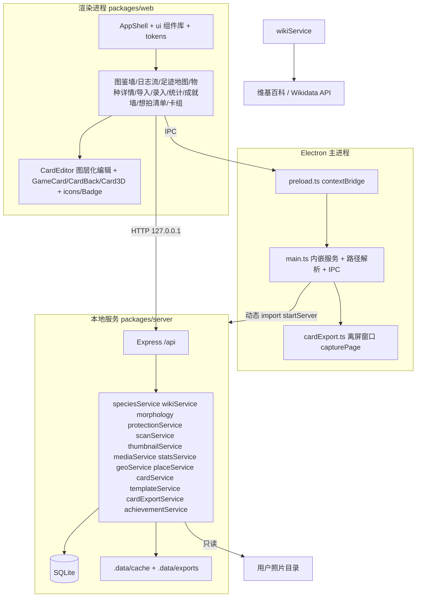

# 我的拍鸟图鉴（Bird Atlas）—— 桌面版图鉴收集应用

## 产品概述

一个本地运行的「我的拍鸟/动物图鉴」桌面应用：把我拍摄到的鸟类与动物照片收集成图鉴，录入物种名称后自动从维基百科与 Wikidata 抓取准确的物种资料，并以「我拍到的照片 + 该物种简介」为核心，配合**照片墙、足迹地图、时间热力日历、装备统计、成就体系、高自由度动物卡编辑器（固定比例 · 摄影元素卡背 · 3D 拖拽展示）**与**Steam 风格徽章系统**浏览、检索、统计与收集；全应用遵循**统一设计系统**，所有页面视觉与交互一致。

## 核心功能

- **物种录入与自动抓取**：中文名（或学名/英文名）维基候选补全；自动抓取名称、分类、IUCN 与国内保护级别、形态、分布栖息地、中英双语简介与配图（完整简介在物种详情页展示，卡面只放精简摘要）。
- **照片扫描导入**：递归扫描本地目录，EXIF 解析，缩略图生成，哈希去重，进入「待分类」池（原图只索引、不复制）。
- **拍摄装备与地点时间**：机身/镜头/焦距/光圈/快门/ISO；GPS 落点与常用地点库；时间用于日志流、热力日历、连续打卡。
- **动物卡制作（高自由度）**：自动生成 → 逐元素手动微调（图层化编辑、自由文本/贴纸、颜色字体覆盖、预设与模板）；**文本容量参考游戏王，短而精炼**；固定比例；五套卡背（含镜头印花）；3D 拖拽展示；PNG 导出与打印拼版。
- **想拍清单 Wishlist**、**成就体系**（约 32 项）、**图标与徽章系统**。

## 设计系统与 UI 一致性

### 一、设计令牌（唯一来源 `web/src/theme/tokens.ts`）

- **色彩**：背景 `#0F1512` / `#16201B` / `#1E2A24`；主色苔绿 `#57C785`、`#3E9E6B`，羽青 `#6FB3C9`；文本 `#E8EFE9` / `#9FB0A5` / `#6E7F74`；功能色琥珀金 `#E8B04B`、成功 `#4FBF7B`、警示 `#E5636F`、辅助 `#7FD1A5`
- **圆角**：`sm 6 / md 10 / lg 16 / xl 22 / card 2.6%卡宽`；**阴影**：`elev-1/2/3` + 1px 内描边 `rgba(255,255,255,0.06)`
- **玻璃质感**：`bg-white/[0.04] + backdrop-blur-md + border-white/[0.08]`
- **间距**：4 的倍数栅格；**字阶**：`display 28/600`、`title 18/500`、`body 14/400`、`caption 12/400`、`micro 10/500`
- **动效**：`fast 120 / base 200 / slow 320 / flip 600` ms，缓动 `cubic-bezier(0.22,1,0.36,1)`；hover 位移 2–4px
- **焦点**：`outline: 2px solid rgba(87,199,133,.6)` offset 2px；对比度 ≥ 4.5:1；`prefers-reduced-motion` 降级

### 二、统一组件层（`components/ui/`）

`Button`（5 变体 × 3 尺寸）、`IconButton`、`Input`、`Textarea`、`Select`、`Combobox`、`Switch`、`Checkbox`、`Slider`、`Tabs`、`Segmented`、`Dialog`、`Drawer`、`Popover`、`Tooltip`、`Toast`、`Skeleton`、`EmptyState`、`Progress`、`Badge`、`Card`、`Panel`、`Divider`、`ScrollArea`；页面只组合不用裸色值。

### 三、统一布局骨架 `AppShell.tsx`

顶部导航固定 `h-14`；内容区 `pt-14 pb-9`、`px-6`；底部状态栏固定 `h-9`；页面结构「标题行 → 概览/筛选条 → 主体 → 空态」；浮层统一 Dialog（窄窗口 Drawer），遮罩 `bg-black/60 backdrop-blur-sm`。

### 四、一致性检查清单

① 只用令牌色 ② 只用统一组件 ③ 骨架一致 ④ 空态/骨架/错误三态齐全 ⑤ 图标线宽 1.5 统一 ⑥ hover/active/focus/disabled 一致 ⑦ 卡片比例与栅格一致 ⑧ 动效时长缓动一致。

## 动物卡系统设计

### 卡片比例与一致性规范

**唯一比例**：`CARD_RATIO = 59 : 86`（≈0.6860），正反面与所有档位共用。

| 档位 | 尺寸 | 用途 |
| --- | --- | --- |
| `xs` | 118 × 172 | 卡组墙缩略 |
| `sm` | 295 × 430 | 列表/侧栏 |
| `md` | 590 × 860 | 卡片详情 |
| `lg` | 1000 × 1458 | 导出标准 |
| `xl` | 1500 × 2187 | 高清导出 |
| `print` | 2000 × 2916 | 打印/拼版源图 |


根节点 `aspect-ratio: 59/86` + `container-type: size`，内部只用 `cqw/cqh` 与百分比；`card/cardMetrics.ts` 为唯一尺寸来源。

**区域网格（纵向 % 卡高，唯一来源 `card/cardMetrics.ts` 的 `CARD_REGIONS`）**：卡名条 1.4–10.12% / 星级行 10.12–15.35% / 卡图框 15.58–72.56%（高:宽 = 1:1 正方形，宽 `ART_WIDTH ≈ 83.06%` 卡宽、左右内缩 `ART_INSET ≈ 8.47%`）/ 文本外框 72.56–94.65%（框内自上而下：类型行 73.0–75.9% → 简介 4 行 76.15–85.8% → 拍摄记录 2 行 85.8–89.8% → 分隔线 + 右对齐 ATK/DEF 90.2–94.1%）/ 页脚 95.12–99.19%；卡包编号浮标压在卡图右下角 69.6–72.2%；卡名条内边距 `CARD_PADDING = 5%`、文本外框内边距 1.6%；描边 1.2%、卡角直角（`CARD_RADIUS = 0`）。

### 文本容量规范【本次调整，对齐游戏王密度】

游戏王卡面文本短而密：效果框约 6–8 行、每行 22–28 字。卡面因此采用**精简文本**策略（完整资料仍留在物种详情页）：

| 元素 | 上限 | 说明 |
| --- | --- | --- |
| 称号 | 12 字 | 超出自动缩小字号（最低 0.8×） |
| 中文名 | 10 字 | 8 字内为标准字号，9–10 字自动缩排，>10 字截断加「…」 |
| 类型行 | 22 字 | 如「鸟纲·鹈形目/鹭科 涉禽」，过长时省略亚级 |
| **物种简介** | **90 字** | 由维基导语自动摘要为 2–3 句，卡面限 4 行 |
| **拍摄记录** | **50 字** | 一行日期+地点，一行机身/镜头或心得，限 2 行 |
| **效果框总计** | **140 字 / 6 行** | 硬上限，超出红字提示且不保存超长部分 |


**排版参数**：框内文本自上排满 6 行（简介 4 行 + 拍摄记录 2 行，末行之下留白堆在分隔线之上），简介字号按卡宽 2.9%（lg 档约 29px）、行高 3.4% 卡宽，记录字号 2.1%、行高 2.77% 卡宽；`line-clamp` 截断并以「…」结尾；文本不足时底部留白（不拉伸行距）。

**自动精简机制** `summarizeForCard()`（纯函数）：

1. 取维基导语，按句号/分号切句
2. 优先保留含「体长/栖息/分布/习性/食性」等关键词的句子
3. 逐句累加至 ≤90 字，末句若在句中截断则回退到上一句完整边界
4. 去掉括号补充、参考文献标记、学名重复
5. 记录 `summary_source(auto|manual)`，编辑页提供「自动精简」按钮与手动改写；手动改写后不再被自动覆盖

**卡面不含**：完整维基正文、英文简介、形态量规条、长 EXIF 串（这些只在物种详情页与可选贴纸/卡背印花中体现）；卡背 `exifRing` 保留一行短参数。

### 卡面布局

```
┌───────────────────────────────┐
│ 晨雾中的白鹭                    │  称号（≤12 字）
│ 【卡名】白鹭        ★★★★★★☆☆  │  中文名（≤10）+ 右上星级
│ 属性[泽]                       │
├───────────────────────────────┤
│        卡图（4:3 固定裁切）      │
├───────────────────────────────┤
│ 鸟纲·鹈形目/鹭科  涉禽          │  类型行（≤22 字）
├───────────────────────────────┤
│ 中型涉禽，通体白色，栖息于       │  物种简介（≤90 字 / 4 行）
│ 湿地与稻田，以鱼虾为食。         │
│ ─────────────────────────────  │  细分隔线
│ 2025-04-06 · 崇明东滩          │  拍摄记录（≤50 字 / 2 行）
│ 600mm f/4 手持守候两小时        │
├───────────────────────────────┤
│ ATK 2600          DEF 1800     │  双数值（标签可自定义）
│ No.BA-0037             [UR]   │
└───────────────────────────────┘
```

### 属性（8 种）

林（苔绿 #57C785）/ 泽（青碧 #6FB3C9）/ 原（麦金 #C9B24B）/ 海（深蓝 #4B7FC9）/ 山（岩灰紫 #8A7FA8）/ 空（天青 #7FC4E5）/ 夜（幽紫 #6A5C9E）/ 都（石灰 #9FB0A5）；由 `habitats` + 科属自动推断，可手改。

### 星级（1–10）

IUCN 基础（CR 7 / EN 6 / VU 5 / NT 3 / LC 2 / DD 2）+ 国内一级 +2 / 二级 +1 + 三有 +0.5 + 记录次数（1 次 +2 / 2–3 次 +1 / ≥10 次 −1）+ 首次记录 +1 + 想拍达成 +1；上限 10 下限 1，可手调。

### 数值（ATK / DEF，0–4000）

- ATK 珍稀值 = 星级 × 300 + 保护加成（一级 500 / 二级 300）− 50 × min(记录次数, 6)
- DEF 记录值 = 照片数 × 120 + 五星照 × 200 + 资料完整度 × 800 + 行为/繁殖照 300
- 可手调，卡面标注数值来源；数值标签默认精简为 `ATK / DEF`（可在编辑器改回含中文说明）

### 稀有度（卡框与闪膜）

N（≤3 星，哑光）/ R（4–5，银字细闪）/ SR（6–7，闪膜碎光）/ UR（8–9，金边镭射）/ 传说（10 星或手动，虹彩边 + 粒子）。卡框按类群配色，传说强制虹彩框。

### 卡片自由编辑器 `/cards/editor/:id`

**图层化编辑**：卡面 16 图层（`frame/title/name/scientific/attribute/stars/art/typeLine/effect/record/atk/def/serial/rarity/holo/watermark`）+ 卡背 4 图层（`backBase/backEmblem/backPrints/backText`）；每项可调 显示/隐藏、锁定、顺序、位置偏移（拖拽 + 方向键 0.5% 步进）、缩放 0.6–1.6、旋转 ±15°、颜色、字号档位/字重/斜体/字距、阴影/描边/透明度/渐变、文本内容。

**自由元素**：自定义文本层（签名/日期/标语）、本地贴纸层（logo/印章，含混合模式）、水印层。

**文本编辑**（对齐新容量）：

- 简介与记录两个输入框均显示实时计数 `86/90`、`48/50`，超限红字并阻止保存
- 「自动精简」按钮：一键调用 `summarizeForCard()` 重写简介至 ≤90 字
- 「按句截断」与「移除括号内容」两个快捷工具
- 预览区显示真实卡面行数，超行即时提示（因为字宽不等，行数与字数双重校验）

**预设与模板**：内置 4 套预设（经典/博物/暗夜/极简）；我的模板可保存与批量应用；重置支持整卡 / 单图层 / 仅卡背 / 仅裁切四种粒度。

**编辑体验**：撤销重做 ≥50 步、参考线与网格吸附、画布缩放 50–200%、正反面与 3D 实时预览、字数与越界校验、复制图层、复制为新版本。

**数据结构**：`cards.overrides`（图层微调）、`cards.layers`（自定义层）、`cards.template_id`；`card_templates` 表；解析优先级 `默认规则 → 预设/模板 → overrides → layers`，由 `resolveCardStyle()` 纯函数统一解析，正面/背面/3D/导出共用。

### 卡背设计【含相机镜头印花】

与正面同尺寸同比例，三层：**底纹主题**（羽脉/年轮/星图/镜头光圈/自定义）+ **镜头印花层**（光圈叶片、焦段刻度环、卡口三爪、胶片齿孔、取景框角标、快门帘幕、EXIF 微缩文字环、机身剪影，参数由 EXIF 聚合生成可手改）+ **文字层**（弧形应用名 + 中文与卡号 + 自定义一行，字数上限同卡面：自定义行 ≤20 字）。

### 3D 卡片展示

`Card3D.tsx`（纯 CSS 3D）：`perspective: 1200px` + `preserve-3d`；拖拽 `rotateY` 360° / `rotateX` ±28°，松手惯性衰减（阻尼 0.94）+ 吸附归位；双击/空格翻面 600ms；滚轮/双指整体缩放 0.8–2.2；伪光照随角度偏移；两层薄片模拟纸厚；自动摆动 ±18°；键盘 F/R/方向键；导出支持当前角度与标准正/背面。

### 卡组浏览

等比栅格 + 3D hover 倾斜与高光跟随；按稀有度/属性/类群/卡组册筛选，按星级或时间排序；卡详情浮层可拖拽看正反面、切换卡图与卡背、进入编辑器。

### 导出与打印

单卡 PNG（`lg`/`xl`，正面/背面/当前角度）、批量 Zip、A4 拼版（3×3 + 裁切角标 + 双面镜像 + 可选出血）、分享图（正背双卡图）；导出沿用 `resolveCardStyle()` 结果，所见即所得。

## 物种资料（简介）内容设计

- **A 自动抓取**：中文名/学名/英文名/别名；目科属（`P171` 回溯）；IUCN（`P141`）+ 评估年；中英双语**完整**简介（详情页展示全文）；资料图（`P18`）；来源链接、QID、抓取时间
- **B 尽力解析**：体长/体重/翼展（量规条）；分布（`P183` + 正文）；栖息地标签；居留型与生态型
- **C 本地名录**：内置《国家重点保护野生动物名录》精简版（约 500–600 条），学名 → 中文名 → 去属名前缀 → 属级匹配；「三有」标记
- **D 自己补录**：备注、标签、收藏、稀有度自评、鸣声/视频本地文件
- **E 展示形态**：详情页展示完整信息（图标化信息卡、面包屑、双盾牌、量规条、栖息地标签、双语切换、资料图角标、鸣声占位卡、完整度进度条）；**卡面只承载精简摘要**（见文本容量规范）

## 成就系统

静态定义 + SQL 聚合进度 + 落库解锁时间；成就只增不减；新解锁轮询弹统一 toast。九大类约 32 项，卡牌类 6 项：`card-first` 首张卡（铜）/ `card-decade` 卡组初成（银，10 张）/ `card-ur` 闪卡大师（金）/ `card-back` 双面收藏家（银）/ `card-gear` 器械印记（铜）/ `card-designer` 卡牌设计师（银，保存 1 个自定义模板）。

## 图标与徽章系统

- **通用外壳 `Badge.tsx`**：圆形金属徽章，40/56/72/96 四档；铜 `#8A5A2B→#C98A4B→#F0C08A`、银 `#6E7F88→#AEBAC4→#E6EEF4`、金 `#8A6412→#E8B04B→#FFE3A3`、传说 `#2F6E4E→#57C785→#6FB3C9`；未解锁灰度 + 进度环；解锁扫光 + 上浮
- **图标库**：成就 30+、装备 7、地点与栖息地 6、类群 5、保护盾牌 8、卡牌属性 8、稀有度角标 5、卡背纹章 5、镜头印花元件 7；统一 24 viewBox、线宽 1.5

## 技术栈

- **桌面壳**：Electron + electron-builder（win x64 `dir`），主进程内嵌本地服务 + 离屏窗口截图
- **本地服务**：Node 20+ / TypeScript / Express 4 / better-sqlite3 / sharp / exifr / zod / pino / archiver
- **前端**：React 18 + Vite 5 + TypeScript 5 + TailwindCSS 3.4.17 + tailwindcss-animate + Radix UI + @tanstack/react-query + react-router-dom + zustand + sonner + lucide-react + recharts
- **设计系统**：`theme/tokens.ts` + `components/ui/`（Radix + Tailwind），不使用 shadcn
- **卡面与 3D**：DOM + CSS 3D + SVG 印花 + `cqw/cqh` 等比；不引入 three.js 与 canvas 绘图库；导出走 Electron `capturePage`
- **地图**：`d3-geo` + `world-atlas` + `topojson-client`，后端 `/api/geo/world`，完全离线
- **数据**：SQLite `.data/atlas.db`；缓存与导出 `.data/cache`、`.data/exports`

## 架构设计



## 数据模型（SQLite 迁移建表）

- `species`：`id / group / cn_name / scientific_name / en_name / aliases / order_name / family_name / genus_name / iucn_status / iucn_year / cn_protection_level / cn_protection_source / is_sanyou / length_cm / weight_g / wingspan_cm / morphology_source / distribution / habitats / residence_type / diet / eco_type / summary_zh / summary_en / wiki_title / wiki_url / wiki_en_url / qid / wiki_image_key / image_credit / sound_path / video_path / fetch_status / fetched_at / cover_photo_id / is_favorite / is_wishlist / wish_note / note / created_at`
- `photos`：同前（含 camera/lens/GPS/EXIF）
- `places`：`id / name / lat / lon / icon_key / note / use_count / created_at`
- `cards`：`id / species_id / title / attribute / stars / stars_source / atk / def / value_source / rarity / photo_id / photo_crop / theme / preset / template_id / overrides / layers / effect_text(≤90) / effect_source(auto|manual) / record_text(≤50) / serial_no / show_scientific / show_exif / holo / back_theme / back_emblem / back_text(≤20) / back_print / back_gear_text / deck_id / sort_order / created_at / updated_at`
- `card_templates`：`id / name / preset / overrides / layers / back_config / preview_card_id / created_at / updated_at`
- `decks`、`achievement_state`、`wiki_cache`、`scan_jobs`、`library_roots`：同前

派生统计：物种数、照片数、地点数、科/目数、机身镜头物种数、每日/每月拍摄量、连续打卡、保护级别覆盖、栖息地分布、五星照片数、想拍达成率、卡片数与稀有度分布。

## 维基/Wikidata 抓取策略

1. 候选：`list=search`（zh.wikipedia.org）+ `wbsearchentities&uselang=zh` 兜底
2. 中文详情：`prop=extracts|pageimages|pageprops|langlinks&exintro&explaintext`
3. 英文详情：经 `langlinks` 取英文标题导语
4. 结构化：`wbgetentities` 取 `P225`/`P105`/`P171`/`P141`/`P183`/`P18` 与 `labels.zh/en`
5. 形态抽取：中英正文正则
6. 栖息地与居留型、生态型抽取
7. 国内保护：`protectionService` 内置名录匹配
8. **卡面摘要**：`summarizeForCard()` 从 `summary_zh` 生成 ≤90 字卡面文本（写 `cards.effect_text`，`effect_source=auto`）
9. 缓存：`wiki_cache` + 图片落 `.data/cache/wiki/`；失败置 `failed` 可重试
10. 礼貌抓取：固定 UA、并发 2、退避重试 2 次、超时 10s

## 扫描与媒体访问

- 扫描：递归遍历（jpg/jpeg/png/webp/heic/raf/cr2/arw/nef/dng 等），`exifr` 解析，`sha256` 抽样去重，`p-limit` 限流，事务 upsert，进度写 `scan_jobs`
- 缩略图：240/640/1600 三档 webp；卡图按 `photo_crop` 归一化裁切
- 媒体接口：`/api/media/photo/:id/thumb?size=`、`/api/media/photo/:id/full`、`/api/media/wiki/:key`、`/api/media/species-asset/:id?kind=sound|video`、`/api/media/asset/:key`（贴纸）、`/api/exports/:file`

## 可视化展示设计

1. **物种卡片（马赛克封面）**：照片拼贴 + 渐变 + 中文名/学名；双盾牌 + 首次记录羽毛徽章 + 稀有度星级
2. **拍摄日志流**：按日期倒序瀑布流，组头日期 + 地点徽章 + 张数 + 相机/镜头迷你徽章
3. **足迹地图**：d3-geo SVG 发光气泡，缩放/聚合/下钻，栖息地筛选，未定位补录，OSM 打开
4. **拍摄热力日历**：年度贡献图，年份切换，点击筛选
5. **装备与统计图表**：镜头 × 物种数、机身环形图、月度面积图、目科/保护/栖息地分布、收集进度环
6. **成就墙**：大徽章网格 + 完成度环 + 进度环 + 扫光 toast
7. **物种详情**：头图视差 + 面包屑 + 双盾牌 + 成就徽章 | 照片网格 + 参数徽章条 | 完整资料面板 +「制作卡片」
8. **想拍清单板**：占位封面 + 目标徽章 + 达成进度环
9. **动物卡**：精简文本卡面 + 等比卡组墙 + 3D 浮层 + 全屏自由编辑器 + 等比导出与 A4 拼版

## 实现注意事项

- 主进程须先写好 `BA_DATA_DIR / BA_WEB_DIST / TEMP` 再 `await import('@ba/server')`；`better-sqlite3`、`sharp` 需在 `asarUnpack` 解包，`npmRebuild: false`
- **文本容量（硬约束）**：`cardRules.ts` 定义并服务端校验 `title ≤12`、`cn_name ≤10`、`typeLine ≤22`、`effect_text ≤90`、`record_text ≤50`、`back_text ≤20`、效果框总计 ≤140 字；超限返回明确错误，不静默截断（自动精简只在生成阶段做，且保留完整原文在 `species.summary_zh`）
- **行数与字数双重校验**：因中文字宽不等，卡面渲染后需按实际行数校验（简介 ≤4 行、记录 ≤2 行），编辑器预览即时反馈
- **UI 一致性**：颜色/圆角/阴影/间距/字阶/动效一律取自 `theme/tokens.ts` 与 `components/ui/`；按八条检查清单逐页核对
- **卡编辑器性能**：zustand 单 store + 选择器；拖拽缩放写 CSS 变量；撤销栈存图层 JSON（≤50 步）；贴纸压缩后存路径
- **样式解析唯一**：`resolveCardStyle()` 纯函数，卡面/卡背/3D/导出/拼版共用
- **比例一致性**：根节点 `aspect-ratio: 59/86` + `container-type: size`，内部只用 `cqw`
- **3D 卡**：只用 CSS transform；角度写 CSS 变量；正反两面 `backface-visibility: hidden`
- **镜头印花**：纯函数集中在 `card/prints.ts`，刻度 ≤72、齿孔 ≤40
- **截图一致性**：`/cards/print/:id` 无 chrome、窗口尺寸等于档位、`deviceScaleFactor=1`、字体图形全本地；`window.__cardReady = true` 后截图
- 后端沿用 `ApiError + notFoundHandler + errorHandler` 与 zod 校验（含 `overrides`/`layers`/`back_print`/`photo_crop` schema 与字数上限）；TS strict；`typecheck` 覆盖三包
- 数据目录：`BA_DATA_DIR` → 程序目录 `.data` → `%APPDATA%/BirdAtlas` 兜底
- 单文件不超过 300 行，组件拆分清晰

## 目录结构

```
bird-atlas/
├── package.json                  # npm workspaces 根：dev/build/dist/typecheck
├── README.md                     # 启动、打包、数据目录、抓取源、名录、设计系统与卡牌规则说明
└── packages/
    ├── server/
    │   ├── package.json, tsconfig.json
    │   └── src/
    │       ├── config.ts, logger.ts, app.ts, index.ts
    │       ├── data/
    │       │   ├── cnProtection.ts
    │       │   └── cardRules.ts        # 属性推断、星级/ATK/DEF/稀有度、字数上限、印花默认、内置预设
    │       ├── db/                     # index.ts / migrations.ts / queries.ts
    │       ├── services/
    │       │   ├── speciesService.ts
    │       │   ├── wikiService.ts
    │       │   ├── morphology.ts
    │       │   ├── protectionService.ts
    │       │   ├── summarize.ts        # [NEW] summarizeForCard() 卡面摘要纯函数
    │       │   ├── scanService.ts
    │       │   ├── thumbnailService.ts
    │       │   ├── mediaService.ts
    │       │   ├── statsService.ts
    │       │   ├── geoService.ts
    │       │   ├── placeService.ts
    │       │   ├── cardService.ts       # 默认值、摘要生成、字数与比例校验、CRUD
    │       │   ├── templateService.ts
    │       │   ├── cardExportService.ts
    │       │   └── achievements/        # definitions.ts / metrics.ts / service.ts
    │       └── api/
    │           ├── utils.ts
    │           └── routes/       # health、species、photos、wiki、scan、media、stats、geo、places、achievements、wishlist、cards、templates、decks、exports、roots
    ├── web/
    │   ├── package.json, vite.config.ts, tailwind.config.js, postcss.config.js, index.html
    │   └── src/
    │       ├── main.tsx, App.tsx, index.css, desktop.d.ts
    │       ├── theme/
    │       │   ├── tokens.ts
    │       │   └── tokens.css
    │       ├── components/
    │       │   ├── AppShell.tsx
    │       │   ├── ui/                  # 统一组件层
    │       │   ├── Badge.tsx
    │       │   ├── SpeciesCard.tsx, MosaicCover.tsx, PhotoGrid.tsx, Lightbox.tsx
    │       │   ├── SpeciesInfoPanel.tsx, RangeBar.tsx, SoundPlaceholder.tsx, WishlistBoard.tsx
    │       │   ├── WikiPanel.tsx, ExifBadgeBar.tsx, FilterBar.tsx, TopNav.tsx, StatusBar.tsx, StatTiles.tsx
    │       │   ├── AchievementCard.tsx, AchievementWatcher.tsx
    │       │   └── charts/
    │       ├── icons/
    │       │   ├── registry.ts
    │       │   ├── achievementIcons.tsx
    │       │   ├── gearIcons.tsx
    │       │   ├── placeIcons.tsx
    │       │   ├── taxonIcons.tsx
    │       │   └── cardIcons.tsx
    │       ├── card/
    │       │   ├── cardMetrics.ts
    │       │   ├── resolveCardStyle.ts
    │       │   ├── layerSchema.ts
    │       │   ├── presets.ts
    │       │   ├── GameCard.tsx
    │       │   ├── CardBack.tsx
    │       │   ├── CardBackPrints.tsx
    │       │   ├── prints.ts
    │       │   ├── CardLayers.tsx
    │       │   ├── Card3D.tsx
    │       │   ├── useCardDrag.ts
    │       │   ├── HoloLayer.tsx
    │       │   ├── StarRow.tsx
    │       │   ├── CardViewer.tsx
    │       │   └── cardTheme.ts
    │       ├── editor/
    │       │   ├── CardEditorPage.tsx
    │       │   ├── LayerPanel.tsx
    │       │   ├── LayerInspector.tsx
    │       │   ├── TextLayerTool.tsx    # 含字数计数与「自动精简」
    │       │   ├── StickerTool.tsx
    │       │   ├── PresetPicker.tsx
    │       │   ├── EditorCanvas.tsx
    │       │   └── useEditorHistory.ts
    │       ├── api/
    │       ├── map/
    │       └── pages/                   # AtlasPage、SpeciesPage、SpeciesEditPage、InboxPage、StatsPage、MapPage、AchievementsPage、WishlistPage、CardsPage、CardPrintPage
    └── desktop/
        ├── package.json, electron-builder.yml, build/icon.ico
        ├── scripts/
        └── src/                         # paths.ts、main.ts、preload.ts、window.ts、cardExport.ts
```

## 设计风格

「深夜自然图鉴」：深墨绿近黑底承载照片，照片是唯一高饱和元素；卡片低透明玻璃质感 + 细描边分层；主色苔绿 `#57C785` 与羽青蓝 `#6FB3C9`，琥珀金 `#E8B04B` 用于首次记录、稀有与成就徽章。徽章与卡牌金属渐变 + 高光弧 + 内阴影；卡背深墨绿底 + 同心/放射纹 + 金属细框，镜头印花暗金/枪灰低对比叠加。字体 PingFang SC，display 28/600、title 18/500、body 14/400；卡名较粗字重、字距收紧，卡面文本小而密（参考游戏王），行距紧凑、层次靠字号与分隔线区分。

## 页面规划（10 个路由）

1. **图鉴墙 `/`**：统一顶栏 + 概览条 | 等比卡片网格或日志流瀑布 | 状态栏
2. **物种详情 `/species/:id`**：完整资料（量规条、双语、栖息地、鸣声、来源、完整度）+「制作卡片」
3. **导入待分类 `/inbox`**：扫描控制 + 批量指派
4. **录入/编辑物种 `/species/new`、`/species/:id/edit`**：维基候选 + 抓取预览 + 手动补充
5. **统计 `/stats`**：热力日历、装备战绩、月度面积图、分布图表、地点榜、最近解锁
6. **足迹地图 `/map`**：世界/中国轮廓 + 气泡 + 栖息地筛选
7. **成就墙 `/achievements`**：完成度环 + 分组大徽章
8. **想拍清单 `/wishlist`**：目标卡网格 + 达成进度环
9. **卡组 `/cards`**：等比 3D 卡墙 + 3D 浮层 + 导出
10. **卡片编辑器 `/cards/editor/:id`**：图层面板 + 画布（参考线/吸附/正反面与 3D）+ 检查器（微调、字数计数与自动精简、预设模板、卡背配置、导出）

    - 附 `/cards/print/:id`：离屏打印路由（`?face=&rx=&ry=&size=&bleed=&debug=`）

## 交互与响应式

卡片悬停抬升与渐显、图片骨架屏、日志流无限滚动、地图缩放聚合、批量指派计数、徽章扫光、成就 toast、双语切换、量规条填充、卡牌 3D 拖拽惯性 + 吸附 + 高光 + 翻面 + 缩放 + 自动摆动、编辑器拖拽吸附 + 撤销重做 + 实时预览 + 字数超限时输入框红字与计数变红、导出进度条；窗口自适应 1–4 列（卡片等比），窄窗口 Dialog 降 Drawer、编辑器降为「画布 + 底部抽屉」；`prefers-reduced-motion` 关闭惯性与摆动。

## Agent Extensions

### SubAgent

- **code-explorer**
- Purpose：实现扫描导入、EXIF（装备与 GPS）解析与缩略图服务前，通读 `（同作者的 photo-manager 项目）packages/server/src/services` 下 scanService / thumbnailService / metadataService，照搬并发控制、去重与缩略图缓存策略。
- Expected outcome：与既有项目一致的扫描流水线与缩略图缓存方案，避免性能踩坑。